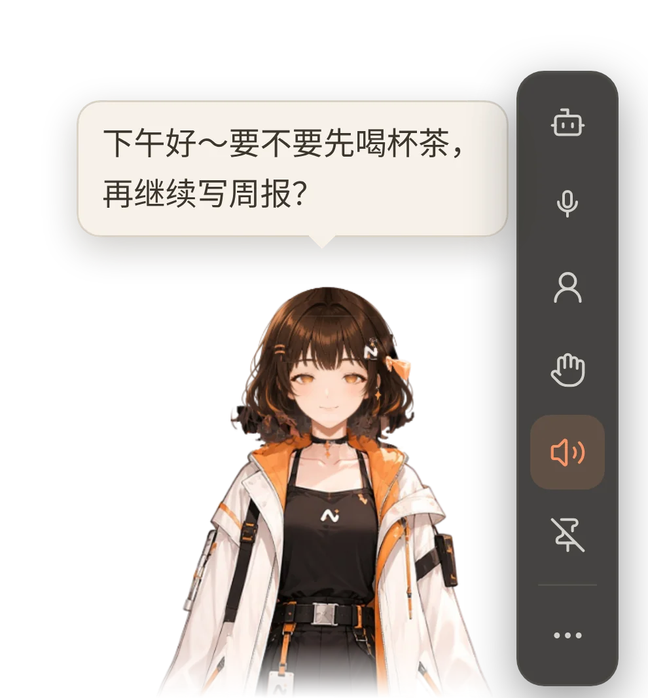
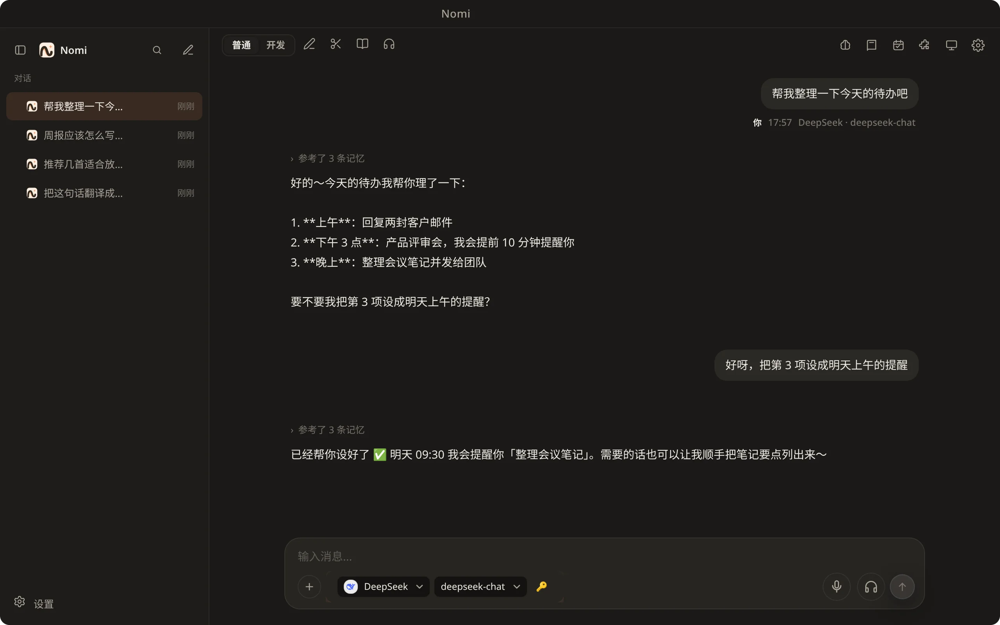
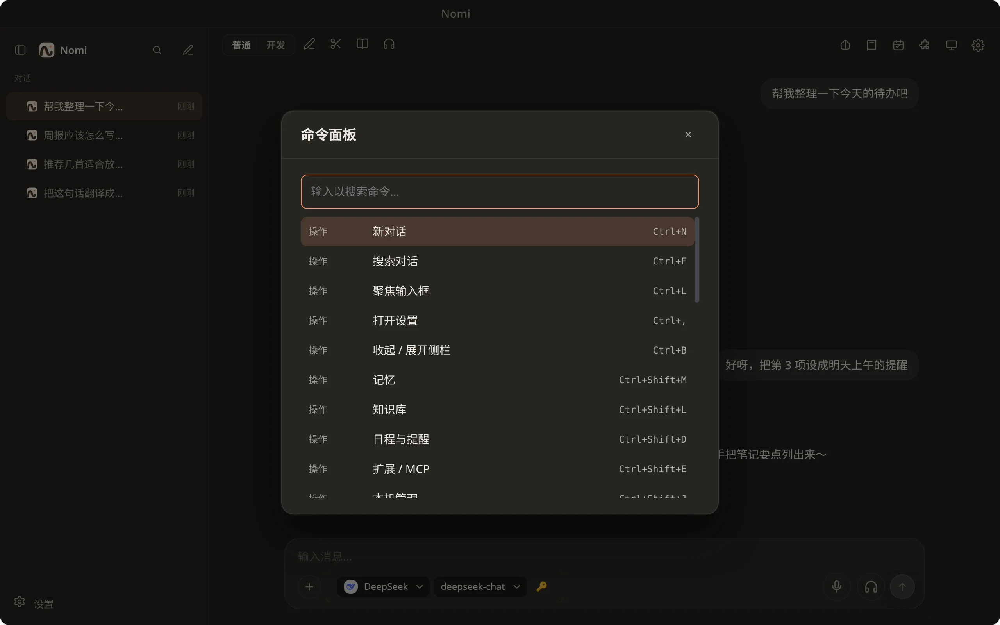
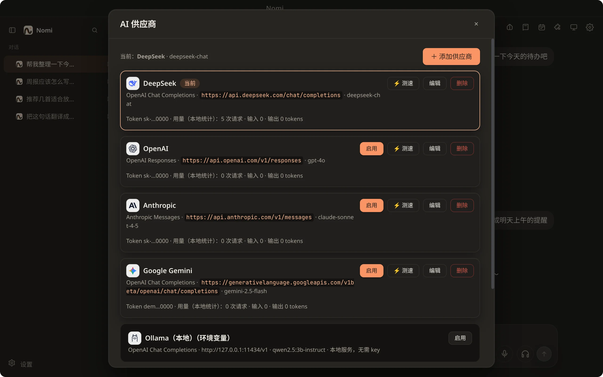
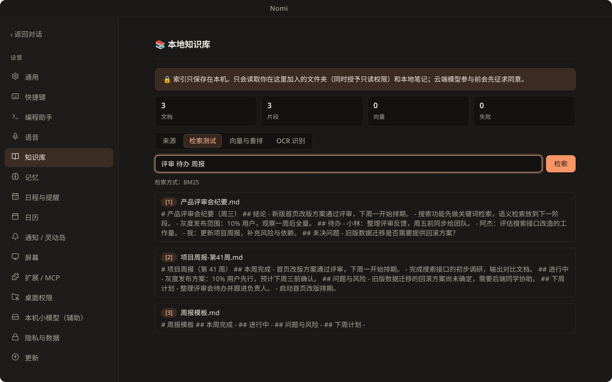
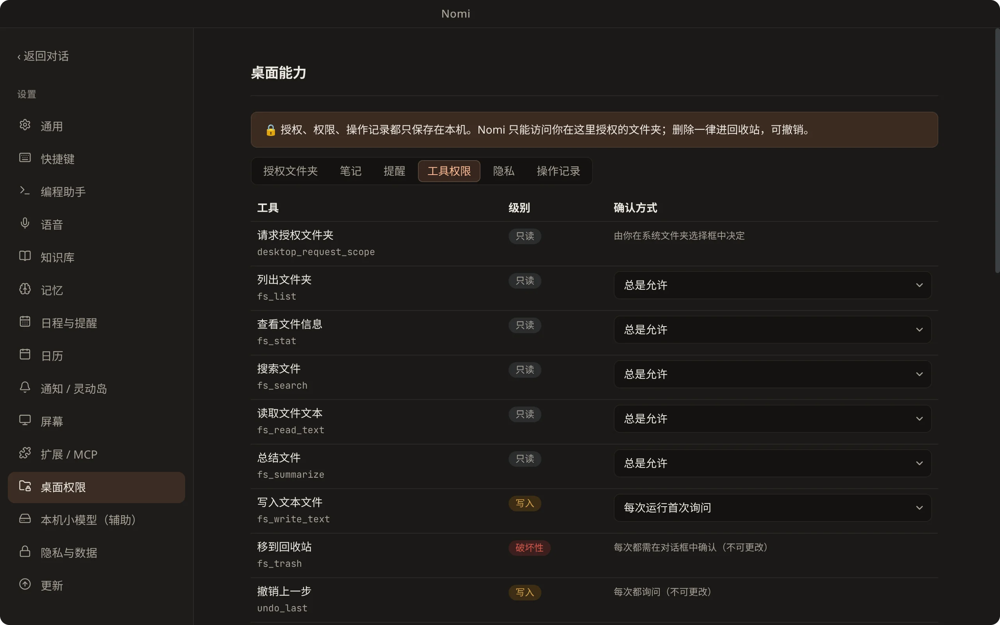
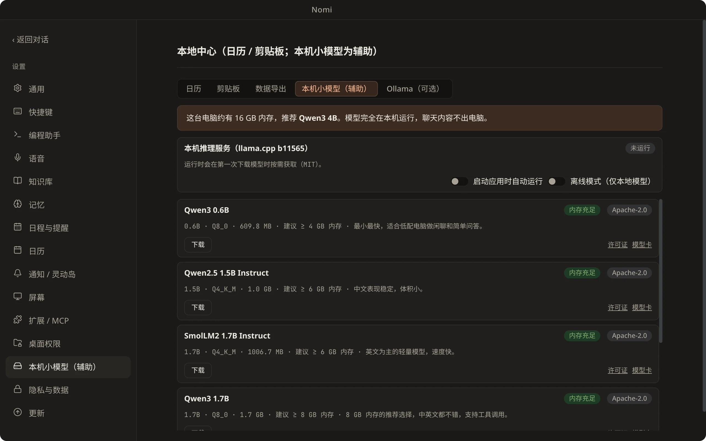

<p align="center"></p>

<h1 align="center">Nomi·诺米</h1>

<p align="center">
  <b>你的桌面 AI 伙伴</b> —— 住在桌面，懂你所想，帮你做到。<br>
  <b>Your desktop AI companion</b> — lives on your desktop, gets what you mean, and gets it done.
</p>

<p align="center">macOS · Windows · Linux　|　MIT</p>

<p align="center">
  <a href="https://github.com/Cookieboty/nomi-ai/stargazers"></a>
  <a href="https://github.com/Cookieboty/nomi-ai/issues"></a>
  <a href="https://github.com/Cookieboty/nomi-ai/releases"></a>
  <a href="https://github.com/Cookieboty/nomi-ai/releases/latest"></a>
  <a href="https://github.com/Cookieboty/nomi-ai/commits/main"></a>
  <a href="LICENSE"></a>
</p>

<p align="center">
  <a href="https://withnomi.app">官网 / Website</a> ·
  <a href="https://github.com/Cookieboty/nomi-ai/releases/latest">下载 / Download</a> ·
  <a href="https://withnomi.app/features">功能 / Features</a> ·
  <a href="docs/README.md">文档 / Docs</a> ·
  <a href="https://withnomi.app/changelog">更新日志 / Changelog</a> ·
  <a href="https://withnomi.app/privacy">隐私 / Privacy</a>
</p>

<p align="center"><a href="#中文">中文</a> · <a href="#english">English</a></p>

## 📸 截图 / Screenshots

<table>
  <tr>
    <td align="center" width="30%"><br><sub>桌面伙伴 / Desktop companion</sub></td>
    <td align="center"><br><sub>对话窗口 / Chat</sub></td>
  </tr>
  <tr>
    <td align="center" colspan="2"> <br><sub>命令面板（Ctrl/⌘+K）· 供应商与模型 / Command palette · Providers & models</sub></td>
  </tr>
  <tr>
    <td align="center" colspan="2">  <br><sub>知识库 · 工具与 MCP · 本地模型 / Knowledge base · Tools & MCP · Local models</sub></td>
  </tr>
</table>

---

## 中文

Nomi 是一个运行在你电脑上的 AI 助手：一位会动、会说话的桌面伙伴，加上一个干净好用的对话窗口。
它能连接你喜欢的云端大模型，也能完全离线使用本地模型；它记得你、会主动提醒你，还能帮你读文件、看屏幕、管日程。

### ✨ 功能

#### 🧸 桌面伙伴 Nomi

- **会呼吸的角色**：分层立绘驱动的伪 3D 骨架——眨眼、视线跟随鼠标、呼吸、头发摆动、说话时口型同步
- **丰富表情**：开心、生气、难过、放松等表情随对话与任务状态自动切换；AI 也能让她做动作、换表情
- **好玩的互动**：摸头、单击、双击各有反应；拖着她甩一甩会手脚乱蹬，松手落到任务栏上弹一弹；可选沿屏幕底边散步，支持多显示器
- **透明不挡事**：只有角色本身可点击，其余区域鼠标直接穿透
- **对话气泡**：回复以气泡显示在她身边，自动避开脸部
- **换个形象**：可从模型商店下载开源 3D（VRM）角色，或导入你自己的 `.vrm` 模型，自定义名字、缩放、取景和表情映射
- **陪你写代码**：可选的编程关键词台词与整点问候
- **拖文件给她**：把文件拖到 Nomi 身上，直接帮你总结

#### 💬 AI 对话

- **简洁的对话窗口**：类 Codex 的平静布局，流式输出，会话列表、侧栏可收起
- **图片与截图提问**：`Ctrl/⌘+Alt+A` 框选屏幕任意区域，直接带图提问
- **快捷命令**：输入框里按 `/` 打开命令，`↑` 找回上一条提问
- **首次引导**：几步完成语言、主题、角色与声音、称呼与语气、模型和隐私设置

#### 🔑 供应商与 Token 管理

- **一键切换**：在对话窗口工具栏或系统托盘里直接切换供应商和模型，立即生效
- **内置预设**：OpenAI、Anthropic、Gemini、DeepSeek、Kimi、智谱 GLM、通义千问、豆包、MiniMax、xAI Grok、OpenRouter、硅基流动、Ollama、LM Studio 等，也可完全自定义
- **获取模型列表**：一键拉取供应商的可用模型，勾选启用、设为默认
- **测速**：发一个极小请求，显示真实延迟
- **多 Key 自动切换**：每个供应商可配置主 Key 与备用 Key，遇到失效或额度用尽时自动切到下一个
- **加密保存**：API Key 用系统钥匙串加密，只保存在本机，界面只显示掩码
- **按任务分配模型**：对话、工具调用、摘要可以分别指定不同的供应商与模型

#### 📚 知识库

- 选几个文件夹或写几条笔记，Nomi 就能基于它们回答，并标出**可点击的引用来源**
- 支持 txt、Markdown、PDF、Word，以及图片里的文字（本地 OCR）
- 增量更新索引；可选接入本地或云端向量模型提升检索效果

#### 🧠 长期记忆

- 对话结束后自动整理成记忆，下次聊到相关话题时自然想起
- 你的个人档案（称呼、偏好）随时可看、可改、可删、可导出

#### ⏰ 主动日程与系统日历

- **提醒**：支持重复规则；错过的提醒在下次启动时补上
- **定时任务**：如「每日简报」，到点生成内容，用气泡 + 系统通知告诉你
- **主动聊天**（默认关闭）：按你设定的频率、活跃时段与免打扰时间偶尔搭话
- **日历**：连接 macOS / Windows / Linux 系统日历，或导入 .ics、订阅日历链接、连接 CalDAV

#### 🖥️ 屏幕问答

- 框选屏幕直接提问
- 可选的**屏幕记忆**（默认关闭）：定时截屏并在本机识别文字，之后可以问「我刚才看的那个页面说了什么」；支持排除应用与自动清理

#### 🧩 MCP 与技能

- 图形界面添加、连接、管理 MCP 服务器，查看工具列表；敏感工具调用前会请你确认
- 支持 `SKILL.md` 技能包：启用、编辑、新建，或从文件夹导入

#### 🏠 本地模型

- 一键下载开源小模型并在本机运行，自动注册为可用的供应商
- 管理本机 Ollama 模型：列出、拉取、删除
- 完全离线也能聊天、做知识库问答

#### 🤖 自动化

- **桌面文件**：授权文件夹后，AI 可以列出、搜索、阅读、总结文件；写入需确认，删除只进回收站并可撤销
- **笔记、提醒与剪贴板历史**（剪贴板默认关闭）
- **受控浏览器**：AI 可在独立、无痕的窗口中浏览公开网页，你能随时看到它在做什么
- **代码沙箱**：在隔离的临时目录里运行 JavaScript / Python 片段
- 所有操作都有本地审计日志

#### 🎙️ 语音

- **语音输入**：本地离线识别，或使用你配置的在线识别服务；支持免按键对话
- **语音播报**：可用系统语音，也可**接入你自己的 TTS 服务**（支持参考音频克隆音色）
- 说话时自动打断播报，Nomi 的口型随声音同步

#### 👀 编程助手监视

- 自动发现本机的 Claude Code、Codex、Cursor、Aider、Cline、Continue，任务完成或需要你操作时用气泡提醒你
- 只读取本机已有的日志与会话文件

#### 🏝️ 灵动岛通知（macOS）

- 消息、编程助手进度和提醒以刘海处的「灵动岛」样式出现；其他平台以顶部胶囊显示

#### 🎨 个性化

- **主题**：暖墨（默认）、石墨、纸白、冷雾，可跟随系统深浅色
- **应用图标**：多款图标可选，窗口、任务栏与托盘即时更新
- **快捷键**：`Ctrl/⌘+K` 命令面板、`Ctrl/⌘+N` 新对话、`Ctrl/⌘+L` 聚焦输入框、`Ctrl/⌘+,` 设置……全部可在设置中查看与改键，并提示冲突
- **中文 / English** 界面，可跟随系统
- **无障碍**：完整键盘操作、焦点管理，并尊重系统「减少动态效果」设置

#### 🔄 自动更新

- 安装版会在后台检查并下载新版本，**经你确认后**才重启安装

#### 🔒 隐私

- 对话、记忆、知识库、日程都保存在本机；可一键导出全部本地数据
- 可开启「仅本地模型」，敏感内容不发往云端

### 📦 下载安装

前往 [GitHub Releases](https://github.com/Cookieboty/nomi-ai/releases/latest) 页面，按你的系统下载对应安装包（macOS 按芯片选 `.dmg`，Windows 选 `.exe`，Linux 选 `.AppImage`），安装即用。文件名里的 `<版本号>` 即 Release 的版本号。

| 系统                         | 安装包                    | 说明                                         |
| ---------------------------- | ------------------------- | -------------------------------------------- |
| macOS · Apple 芯片（M 系列） | `Nomi-<版本号>-arm64.dmg` | 打开后把 Nomi 拖进「应用程序」               |
| macOS · Intel 芯片           | `Nomi-<版本号>.dmg`       | 同上                                         |
| Windows 10+（x64）           | `Nomi-Setup-<版本号>.exe` | 双击运行安装向导                             |
| Linux（x64）                 | `Nomi-<版本号>.AppImage`  | `chmod +x Nomi-<版本号>.AppImage` 后直接运行 |

> 💡 **macOS 提示「已损坏」或无法打开？** 当前安装包尚未经过 Apple 公证（notarize），Gatekeeper 可能拦截从网上下载的应用。先把 Nomi 拖到「应用程序」，再在终端执行：
>
> ```bash
> sudo xattr -dr com.apple.quarantine /Applications/Nomi.app
> ```
>
> 然后重新打开即可。
>
> 💡 **Windows 弹出 SmartScreen？** 当前安装包尚未做代码签名，确认下载来源是本仓库 Releases 后，点「更多信息 → 仍要运行」即可。

### 🚀 快速开始

1. 安装并打开 Nomi，跟着首次引导选择语言、主题和角色。
2. 在「编程助手 → Nomi」里添加一个供应商（填入 API Key），或在「本机管理」里下载一个本地模型。
3. 点击 Nomi 或按 `Ctrl/⌘+N` 开始对话；按 `Ctrl/⌘+K` 浏览全部功能。

### 🛠️ 从源码构建

需要 Node.js ≥ 22.12 和 pnpm 9（`corepack enable`）。

```bash
git clone https://github.com/Cookieboty/nomi-ai.git && cd nomi-ai
corepack enable
pnpm install
pnpm dev                    # 开发模式运行

pnpm test                   # 测试
pnpm package                # 为当前平台打包，产物在 dist/
```

可用 `pnpm run doctor` 检查开发环境。打包与发布说明见 [docs/RELEASE.md](docs/RELEASE.md)。

### 📄 许可证

[MIT](LICENSE)。随应用分发的第三方组件与素材均为开源许可，清单见 [THIRD_PARTY_NOTICES.md](THIRD_PARTY_NOTICES.md)。

### 🙏 致谢

Nomi 构建在这些优秀的开源项目之上：

- [Electron](https://www.electronjs.org/)、[React](https://react.dev/)、[Vite](https://vitejs.dev/)、[Turborepo](https://turbo.build/)、[pnpm](https://pnpm.io/)
- [Vercel AI SDK](https://ai-sdk.dev/) 与 [Model Context Protocol](https://modelcontextprotocol.io/)
- [three.js](https://threejs.org/)、[@pixiv/three-vrm](https://github.com/pixiv/three-vrm)、[react-three-fiber](https://github.com/pmndrs/react-three-fiber) / [drei](https://github.com/pmndrs/drei)
- [whisper.cpp](https://github.com/ggml-org/whisper.cpp)、[llama.cpp](https://github.com/ggml-org/llama.cpp)、[Silero VAD](https://github.com/snakers4/silero-vad)、[ONNX Runtime Web](https://onnxruntime.ai/)
- [Tesseract.js](https://tesseract.projectnaptha.com/) 与 [tessdata_fast](https://github.com/tesseract-ocr/tessdata_fast)、[unpdf](https://github.com/unjs/unpdf)、[fflate](https://github.com/101arrowz/fflate)
- [Zustand](https://github.com/pmndrs/zustand)、[Immer](https://immerjs.github.io/immer/)、[Zod](https://zod.dev/)、[Lucide](https://lucide.dev/)、[react-window](https://github.com/bvaughn/react-window)
- [electron-builder](https://www.electron.build/) 与 electron-updater、[node-global-key-listener](https://github.com/LaunchMenu/node-global-key-listener)
- [Quaternius](https://quaternius.com/) Universal Animation Library（CC0）、[VRoid Project](https://vroid.com/) 样例角色（模型商店）、[Qwen](https://github.com/QwenLM) 开源模型（本地模型目录）

角色、动作与图标的作者和许可也可以在应用内「致谢」页查看。

### 🔗 链接

- [官网](https://withnomi.app)
- [问题反馈](https://github.com/Cookieboty/nomi-ai/issues)
- [更新日志](CHANGELOG.md) · [官网更新日志](https://withnomi.app/changelog)
- [文档](docs/README.md)：功能说明、开发与测试
- [隐私](https://withnomi.app/privacy)

---

## English

Nomi is an AI assistant that runs on your computer: an animated, talking desktop companion plus a clean chat window.
Connect the cloud models you already like, or go fully offline with local models. Nomi remembers you, can nudge you with reminders, and helps with files, your screen, and your calendar.

### ✨ Features

#### 🧸 Desktop companion Nomi

- **A living character**: layered illustration with a pseudo-3D skeleton — blinking, mouse-follow gaze, breathing, hair sway, and lip-sync while speaking
- **Expressive**: happy, angry, sad, relaxed, and more switch with chat and task state; the AI can also trigger motions and expressions
- **Playful interaction**: pet, click, and double-click responses; fling her and she flails, then bounces when she lands on the taskbar; optional walk along the bottom edge, multi-monitor aware
- **Click-through**: only the character is clickable; the rest of the window lets mouse events pass through
- **Chat bubbles**: replies appear beside her, automatically avoiding her face
- **Change look**: download open-source 3D (VRM) characters from the model store, or import your own `.vrm` with custom name, scale, framing, and expression mapping
- **Coding company**: optional coding-keyword lines and hourly greetings
- **Drop files on her**: drag a file onto Nomi for a quick summary

#### 💬 AI chat

- **Calm chat window**: Codex-like layout, streaming replies, session list, collapsible sidebar
- **Ask with images & screenshots**: `Ctrl/⌘+Alt+A` to select any screen region and ask with the image
- **Slash commands**: press `/` in the input; `↑` recalls the last question
- **First-run onboarding**: language, theme, character & voice, how to address you & tone, model, and privacy — in a few steps

#### 🔑 Providers & token management

- **One-click switch**: change provider and model from the chat toolbar or system tray — takes effect immediately
- **Built-in presets**: OpenAI, Anthropic, Gemini, DeepSeek, Kimi, Zhipu GLM, Tongyi Qianwen, Doubao, MiniMax, xAI Grok, OpenRouter, SiliconFlow, Ollama, LM Studio, and fully custom endpoints
- **Fetch model list**: pull available models, enable what you want, set a default
- **Latency check**: a tiny probe request shows real delay
- **Multi-key failover**: primary and backup keys per provider; auto-switch on invalid key or quota exhaustion
- **Encrypted storage**: API keys in the OS keychain, local only; UI shows masked values
- **Per-task routing**: chat, tool calls, and summarization can use different providers and models

#### 📚 Knowledge base

- Point Nomi at folders or notes; answers include **clickable citations**
- txt, Markdown, PDF, Word, plus text in images (local OCR)
- Incremental indexing; optional local or cloud embedding models for better retrieval

#### 🧠 Long-term memory

- Conversations are distilled into memories after chats; related topics come back naturally next time
- Your profile (name, preferences) is viewable, editable, deletable, and exportable anytime

#### ⏰ Proactive schedule & system calendar

- **Reminders**: recurrence supported; missed ones catch up on next launch
- **Scheduled jobs**: e.g. daily briefing — content arrives via bubble + system notification
- **Proactive chat** (off by default): occasional hellos within your frequency, active hours, and do-not-disturb window
- **Calendar**: connect macOS / Windows / Linux system calendars, import .ics, subscribe to feeds, or use CalDAV

#### 🖥️ Screen Q&A

- Select a screen region and ask directly
- Optional **screen memory** (off by default): periodic screenshots with on-device OCR so you can ask “what did that page say?”; app exclusions and auto-cleanup supported

#### 🧩 MCP & skills

- Add, connect, and manage MCP servers in the UI; review tools; sensitive calls ask for confirmation
- `SKILL.md` skill packs: enable, edit, create, or import from a folder

#### 🏠 Local models

- One-click download and run of small open-source models; registered as providers automatically
- Manage local Ollama models: list, pull, delete
- Fully offline chat and knowledge-base Q&A

#### 🤖 Automation

- **Desktop files**: after you grant folders, the AI can list, search, read, and summarize; writes need confirmation; deletes go to trash and can be undone
- **Notes, reminders & clipboard history** (clipboard off by default)
- **Controlled browser**: AI browses public pages in a separate, private window you can watch
- **Code sandbox**: run JavaScript / Python snippets in an isolated temp directory
- All actions have a local audit log

#### 🎙️ Voice

- **Speech input**: local offline recognition, or your configured online STT; hands-free conversation supported
- **Speech output**: system voices, or **your own TTS service** (including reference-audio voice clone)
- Speaking interrupts playback; Nomi’s mouth syncs to the audio

#### 👀 Coding-agent monitor

- Discovers Claude Code, Codex, Cursor, Aider, Cline, Continue on this machine; bubbles when a task finishes or needs you
- Reads only existing local logs and session files

#### 🏝️ Dynamic Island notifications (macOS)

- Messages, coding-agent progress, and reminders appear in a notch-style Dynamic Island; other platforms use a top capsule

#### 🎨 Personalization

- **Themes**: Warm Ink (default), Graphite, Paper White, Cool Mist — can follow system light/dark
- **App icons**: several options; window, taskbar, and tray update instantly
- **Shortcuts**: `Ctrl/⌘+K` command palette, `Ctrl/⌘+N` new chat, `Ctrl/⌘+L` focus input, `Ctrl/⌘+,` settings — all viewable/remappable with conflict hints
- **Chinese / English** UI, can follow the system
- **Accessibility**: full keyboard use, focus management, and respect for system “reduce motion”

#### 🔄 Auto-update

- Installed builds check and download updates in the background; restart/install only **after you confirm**

#### 🔒 Privacy

- Chat, memory, knowledge base, and schedule stay on this machine; export all local data in one click
- Optional “local models only” so sensitive content never leaves for the cloud

### 📦 Download

Open the [GitHub Releases](https://github.com/Cookieboty/nomi-ai/releases/latest) page and download the installer for your system (macOS: pick the `.dmg` for your chip; Windows: `.exe`; Linux: `.AppImage`), then install. `<version>` in the file names is the Release version.

| System                           | Installer                  | Notes                                        |
| -------------------------------- | -------------------------- | -------------------------------------------- |
| macOS · Apple Silicon (M-series) | `Nomi-<version>-arm64.dmg` | Open it and drag Nomi into Applications      |
| macOS · Intel                    | `Nomi-<version>.dmg`       | Same as above                                |
| Windows 10+ (x64)                | `Nomi-Setup-<version>.exe` | Run it to start the installer                |
| Linux (x64)                      | `Nomi-<version>.AppImage`  | `chmod +x Nomi-<version>.AppImage`, then run |

> 💡 **macOS says Nomi “is damaged” or won’t open?** The current build is not Apple-notarized, so Gatekeeper may block apps downloaded from the internet. Move Nomi into Applications, then run this in Terminal:
>
> ```bash
> sudo xattr -dr com.apple.quarantine /Applications/Nomi.app
> ```
>
> Then open it again.
>
> 💡 **Windows shows SmartScreen?** The current installer is not code-signed. After confirming you downloaded it from this repo’s Releases, click “More info → Run anyway”.

### 🚀 Quick start

1. Install and open Nomi; follow onboarding for language, theme, and character.
2. Add a provider under Coding assistants → Nomi (API key), or download a local model under Local management.
3. Click Nomi or press `Ctrl/⌘+N` to chat; `Ctrl/⌘+K` opens everything else.

### 🛠️ Build from source

Requires Node.js ≥ 22.12 and pnpm 9 (`corepack enable`).

```bash
git clone https://github.com/Cookieboty/nomi-ai.git && cd nomi-ai
corepack enable
pnpm install
pnpm dev                    # run in development

pnpm test                   # tests
pnpm package                # package for this platform → dist/
```

Run `pnpm run doctor` to check your dev environment. Packaging and release notes: [docs/RELEASE.md](docs/RELEASE.md).

### 📄 License

[MIT](LICENSE). Third-party components and assets shipped with the app are under open-source licenses; see [THIRD_PARTY_NOTICES.md](THIRD_PARTY_NOTICES.md).

### 🙏 Acknowledgments

Nomi is built on excellent open-source projects:

- [Electron](https://www.electronjs.org/), [React](https://react.dev/), [Vite](https://vitejs.dev/), [Turborepo](https://turbo.build/), [pnpm](https://pnpm.io/)
- [Vercel AI SDK](https://ai-sdk.dev/) and [Model Context Protocol](https://modelcontextprotocol.io/)
- [three.js](https://threejs.org/), [@pixiv/three-vrm](https://github.com/pixiv/three-vrm), [react-three-fiber](https://github.com/pmndrs/react-three-fiber) / [drei](https://github.com/pmndrs/drei)
- [whisper.cpp](https://github.com/ggml-org/whisper.cpp), [llama.cpp](https://github.com/ggml-org/llama.cpp), [Silero VAD](https://github.com/snakers4/silero-vad), [ONNX Runtime Web](https://onnxruntime.ai/)
- [Tesseract.js](https://tesseract.projectnaptha.com/) and [tessdata_fast](https://github.com/tesseract-ocr/tessdata_fast), [unpdf](https://github.com/unjs/unpdf), [fflate](https://github.com/101arrowz/fflate)
- [Zustand](https://github.com/pmndrs/zustand), [Immer](https://immerjs.github.io/immer/), [Zod](https://zod.dev/), [Lucide](https://lucide.dev/), [react-window](https://github.com/bvaughn/react-window)
- [electron-builder](https://www.electron.build/) and electron-updater, [node-global-key-listener](https://github.com/LaunchMenu/node-global-key-listener)
- [Quaternius](https://quaternius.com/) Universal Animation Library (CC0), [VRoid Project](https://vroid.com/) sample characters (model store), [Qwen](https://github.com/QwenLM) open models (local model catalog)

Authors and licenses for characters, motions, and icons are also listed in the in-app Credits page.

### 🔗 Links

- [Website](https://withnomi.app)
- [Issues](https://github.com/Cookieboty/nomi-ai/issues)
- [Changelog](CHANGELOG.md) · [Website changelog](https://withnomi.app/changelog)
- [Docs](docs/README.md): features, development, and testing
- [Privacy](https://withnomi.app/privacy)
