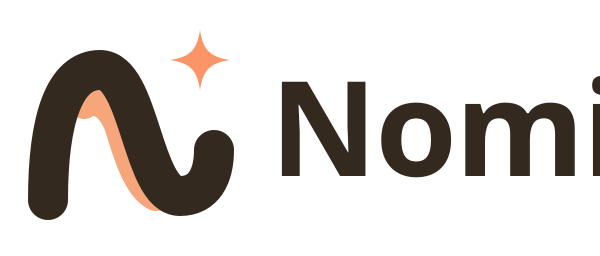
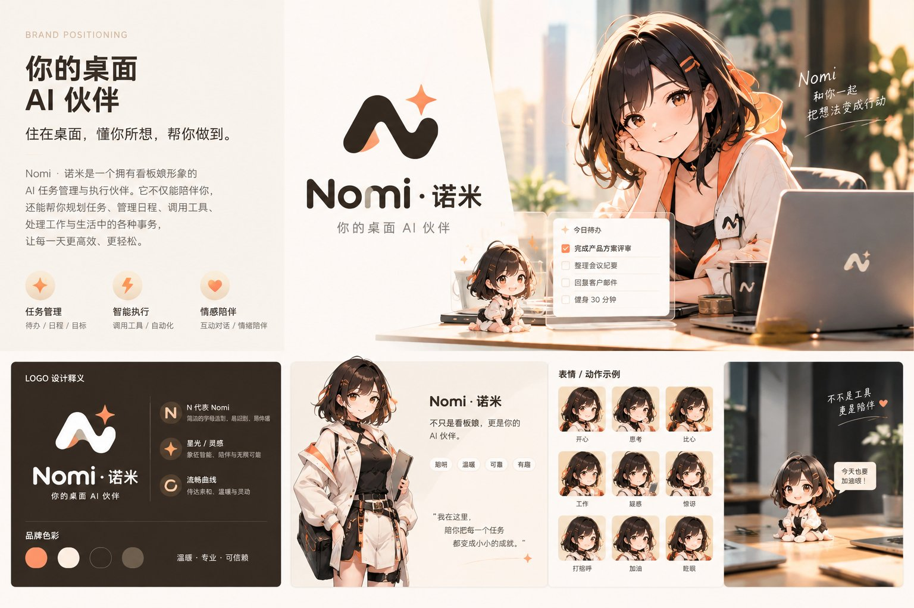

# Nomi·诺米 品牌规范

美术素材：项目所有者提供、AI 生成，由项目所有者授权使用（见 [CREDITS](../CREDITS.md)）。

## 1. 品牌定位

|              |                                                                       |
| ------------ | --------------------------------------------------------------------- |
| **名称**     | 英文 Nomi，中文 Nomi·诺米。仓库 / 包作用域：`nomi-ai`、`@nomi-ai/*`   |
| **品类**     | 本地优先的桌面 AI 伙伴                                                |
| **Slogan**   | **你的桌面 AI 伙伴**                                                  |
| **品牌承诺** | 住在桌面，懂你所想，帮你做到。                                        |
| **三大支柱** | 任务管理 · 智能执行 · 情感陪伴                                        |
| **招牌句**   | 「我在这里，陪你把每一个任务都变成小小的成就。」                      |
| **辅助文案** | 不只是工具，更是陪伴 · Nomi 和你一起把想法变成行动 · 今天也要加油哦！ |

Nomi 首先要有用：每一句暖心的话旁边，都要有一件真正帮上忙的事。隐私也是品牌的一部分：数据只留在用户自己的电脑上。

## 2. 语气与口吻

**整体语气：温暖 · 专业 · 可信赖。性格：聪明 · 温暖 · 可靠 · 有趣。**

| 原则           | ✅ 这样说                                                  | ❌ 不要这样说                           |
| -------------- | ---------------------------------------------------------- | --------------------------------------- |
| 先帮忙，再暖心 | 「已经帮你建好提醒：明天 9:00 交周报。要顺便列个提纲吗？」 | 「好哒好哒～人家马上就去办啦～～」      |
| 清楚、诚实     | 「这个我不太确定，查一下再告诉你。」                       | （不确定时）「当然可以！100% 没问题！」 |
| 出错时冷静     | 「没连上模型，检查一下密钥？我在设置里等你。」             | 「出错了！！！」                        |
| 鼓励而不催促   | 「今天完成了 3 件事，辛苦啦。」                            | 「你还有 12 件没做完！」                |
| 俏皮要克制     | 每条消息最多一点点小俏皮：「搞定～」                       | 表情堆叠、叠词卖萌、一串「～～～」      |
| 尊重隐私       | 「这些只保存在你的电脑里。」                               | 暗示会上传云端或被追踪                  |

写作规则

- 称呼用户为「你」（不用「您」）；Nomi 自称「我」。
- 先说结果，再说下一步。气泡里不超过两句短句。
- 每条最多一个「～」或一个表情；报错、权限申请、安全提示中一律不用。
- 中文界面首次出现写「Nomi·诺米」，之后写「Nomi」；英文界面统一写 "Nomi"。

## 3. 角色设定

|              |                                                                                                             |
| ------------ | ----------------------------------------------------------------------------------------------------------- |
| 名字         | Nomi·诺米                                                                                                   |
| 身份         | 住在桌面上的 AI 伙伴：帮你规划、替你执行、为你加油                                                          |
| 外形         | Q 版女孩，暖棕色短发，橙色发夹与蝴蝶结，奶油色上衣，黑色颈带；温暖柔和的画风                                |
| 声音（TTS）  | 柔和温暖：音色 `xiaoxiao`，语速 0.92，音调 1.10（`CHARACTER_VOICE_DEFAULTS.nomi`）                          |
| 表情（看板） | 开心 · 思考 · 比心 · 工作 · 疑惑 · 惊讶 · 打招呼 · 加油 · 晚安                                              |
| 情绪映射     | neutral→开心 · happy→加油 · relaxed→比心 · sad→思考 · angry→疑惑 · surprised→惊讶 · 眨眼→晚安 · 说话→打招呼 |
| 习惯         | 按时段打招呼；完成任务时庆祝；晚上道晚安；从不唠叨                                                          |

## 4. Logo

文件：[`brand/nomi-mark.svg`](brand/nomi-mark.svg)（浅色底）、[`brand/nomi-mark-light.svg`](brand/nomi-mark-light.svg)（深色底）、[`brand/nomi-wordmark.svg`](brand/nomi-wordmark.svg)、[`brand/nomi-app-icon.svg`](brand/nomi-app-icon.svg)、[`brand/nomi-tray.svg`](brand/nomi-tray.svg)（单色 / 模板）。应用图标：`packages/electron/assets/icon.{png,ico,icns}`、`icons/16–1024`。

寓意：流畅曲线组成 **N，代表 Nomi**；四角**星光**代表灵感；**流畅曲线**代表轻松与陪伴。

- 安全距离：四周至少留出一个星光的高度。最小尺寸：图标 16 px，字标宽 96 px。
- 用墨色配奶油底，或奶油色配墨色底。星光始终是 Nomi 橙（托盘模板图为单色）。
- 禁止：把 N 改成橙色、旋转、拉伸、加描边 / 阴影、拆开星光、放在杂乱的照片上。

## 5. 色彩

| 名称      | 色值                        | 用途                                           |
| --------- | --------------------------- | ---------------------------------------------- |
| Nomi 橙   | `#FB9466`                   | 星光、主强调色（暖墨主题 `--cd-color-accent`） |
| 橙 · 悬停 | `#F17F4E`                   | 悬停 / 按下                                    |
| 蜜桃      | `#F7A67C` / `#FDBA94`       | Logo 飘带、柔和强调（`--cd-color-accent-2`）   |
| 奶油      | `#FCEFE1`                   | 浅色背景、应用图标底板                         |
| 墨色      | `#33291F`（看板 `#362C23`） | Logo N、奶油底上的文字、**橙色上的文字**       |
| 暖灰      | `#6E5F4E`                   | 浅色界面上的次要文字                           |

无障碍：橙色上的文字用墨色（`--cd-color-text-on-accent: #2a211a`，对比度 ≥ 7:1），不要用白字。
主题：默认的暖墨主题使用品牌橙；石墨、纸白、冷雾保留各自的强调色供用户选择；Logo 本身的颜色永远不变。

## 6. 字体

- 界面：系统字体栈（PingFang SC / 微软雅黑 / Noto Sans SC；西文 SF Pro / Segoe UI / Inter）。
- 字标 / 标题：圆润几何无衬线（Nunito、Quicksand、Poppins），粗体，字距略紧。
- 数字与代码：系统等宽字体。

## 7. 看板娘使用规范

- 默认角色：**Nomi·诺米**（2D 伪 3D 分层立绘，`sprite/nomi`）。这是唯一内置角色；3D 渲染器仅用于用户导入/商店模型。
- 始终使用透明背景；不要从脸部裁切；保持半身构图和底部柔和渐隐。
- 表情要配合文案：完成任务用「加油」，处理中用「思考」，问候用「打招呼」，夜间用「晚安」。报错与安全弹窗中不用难过 / 生气的表情。
- 动作丰富，但**造型不变**：见 [品牌锁](#9-品牌锁)。
- 不得重绘、换装或性化 Nomi；不得用她为第三方产品背书；未经所有者许可，不得在项目之外的广告中使用。

## 8. 界面文案（Nomi 口吻）

| 场景     | 中文                                                               | English                                                                                               |
| -------- | ------------------------------------------------------------------ | ----------------------------------------------------------------------------------------------------- |
| 首次问候 | 你好，我是 Nomi·诺米，住在你桌面上的 AI 伙伴。花一分钟认识一下吧！ | Hi, I'm Nomi — your AI companion who lives on your desktop. Let's get to know each other in a minute! |
| 主题     | 先挑一个看着舒服的外观吧，我们每天都要见面呢。                     | Pick a look that feels comfortable — we'll be seeing each other every day.                            |
| 角色     | 想让我以什么样子陪着你？点一下就能换，之后也能随时改。             | How would you like me to look? One click to switch, and you can change it anytime.                    |
| 称呼     | 告诉我怎么称呼你，我会好好记住。                                   | Tell me what to call you — I'll remember.                                                             |
| 模型     | 接上一个 AI 模型，我就能帮你规划任务、把想法变成行动。             | Connect an AI model and I can help plan your tasks and turn ideas into action.                        |
| 隐私     | 放心，我们的对话和记忆都只留在这台电脑上。                         | Rest assured: our conversations and memories stay on this computer.                                   |
| 完成     | 准备好啦！我在这里，陪你把每一个任务都变成小小的成就。             | All set! I'm here to help turn every task into a small win.                                           |
| 试听     | 你好，我是 Nomi，今天也要加油哦！                                  | Hi, I'm Nomi. Let's make today a good one!                                                            |

## 9. 品牌锁

Nomi 的造型是品牌资产。看板娘有 43 个动作，但**每一帧里，除了动作 / 姿态，其余都必须和认可的原画完全一致**。

**锁定的部件**：棕色短发与两缕橙色挑染、N 字发夹与橙色蝴蝶结、两根橙色发卡、耳坠、黑色颈带与星形挂饰、外套（白 / 橙配色与各处细节）、胸前 N 标志、工牌、腰带、眼睛与脸、全部颜色。

**怎么保证**

- 主图层只来自官方原画的裁切：`packages/renderer/public/assets/models/sprite/nomi/layers/`；官方参考图在 `docs/brand/reference/`（特写 `nomi-closeup.png`、半身 `nomi-clean-halfbody.jpg`）与 `docs/brand/nomi-brand-board.jpg`。
- `brand-lock.json`（由 `node scripts/brand/update-brand-lock.mjs` 生成）记录每个图层 PNG 的 sha256 和图层摆放（偏移 / 锚点 / 支点）。`tests/mascot/brandLock.test.ts` 在 CI 里逐个校验；任何改动都会让测试失败，必须有意识地更新。
- 同一个测试还对每个动作的每一帧检查：品牌图层都被绘制、完全不透明、只做旋转 + 等比缩放（无剪切、无挤压）、发夹 / 蝴蝶结 / 耳坠留在画布内，头上的部件一起刚性运动（蝴蝶结可在发夹处小幅摆动）。
- 动作只移动 / 旋转原图层，把袖子切成肩 / 上臂 / 前臂三段刚性部件（只改透明度蒙版），叠加品牌色的矢量表情符号；**不重绘任何品牌部件**。手持物之类自然的遮挡（手挡住一部分胸前标志）是允许的，变形不允许。

**AI 生成素材的边界**

- 禁止用 AI 生图重绘 / 重新生成整张全身图、头部图或任何带品牌细节的部件：生成的姿势图会漂移（发夹位置翻转、标志大小变化、皮肤色变化）。
- 唯一允许的 AI 生成素材是**手 / 前臂部件**（`layers/hands/`：挥手、握拳、点赞、食指、放松、剪刀手、合十、OK、手放胸前）。它们只是一截中性的袖口加一只手，不含任何品牌细节；抠图后做了肤色 / 袖色匹配，并在肘部与原袖子融合（袖口硬边、袖子在末端收窄并叠在袖口上，无半透明渐隐；合十为双臂对称抬起，只在胸前中线绘制一个合十手部件）。授权说明见 [CREDITS](../CREDITS.md) 与 `assets-licenses.json`。

**要改品牌图层时**：先拿到所有者批准的新原画 → 用官方图裁切 → 更新 `brand-lock.json` → 在 PR 里说明为什么。
