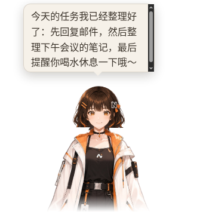

# 桌面伙伴 Nomi

Nomi 住在一个透明、置顶的小窗口里，只有角色本身可以点击，其余区域鼠标直接穿透到下面的窗口。

## 她会做什么

- **表情与动作**：开心、生气、难过、放松等表情随对话和任务状态切换；会眨眼、呼吸、视线跟随鼠标，说话时口型同步。AI 也可以调用工具让她做动作、换表情。
- **互动**：悬停、摸头、单击、双击各有反应（表情 + 动作 + 台词）。按住拖动时手脚乱蹬，松手可选择落到任务栏 / Dock 上并回弹。
- **气泡**：AI 回复的前一两句显示在她身边，自动避开脸部和工具栏；长回复显示「查看全文」，点击打开对话窗口。可在互动设置里关闭。
- **拖文件给她**：把文件拖到她身上，她会总结内容（气泡里一句话，完整摘要写进对话窗口）。

## 工具栏

角色旁边的竖向工具栏：AI 对话、语音、切换角色、动作、置顶等常用按钮，其余在「更多」菜单。空闲时淡出，光标靠近时出现；靠近屏幕边缘会自动翻到另一侧。

## 互动设置

托盘 →「互动设置（穿透 / 重力 / 散步）…」：

| 选项             | 默认 | 说明                                   |
| ---------------- | ---- | -------------------------------------- |
| 透明区域点击穿透 | 开   | 透明像素上的点击交给下面的窗口         |
| 重力与落地       | 关   | 松手后落到任务栏 / Dock 上方，撞墙回弹 |
| 偶尔散步         | 关   | 不时沿屏幕底边走一小段，支持多显示器   |
| 触摸反应         | 开   | 悬停、摸头、点击的反应                 |
| 视线跟随全局鼠标 | 开   | 光标在窗口外时也会看向它               |
| 气泡显示 AI 回复 | 开   | 回复显示在她身边的气泡里               |

## 换个形象

工具栏「切换角色」右键（或托盘「选择角色 / 模型商店…」）打开角色列表：

- **内置角色**：Nomi（默认，分层立绘驱动的伪 3D 骨架）。
- **模型商店**：浏览开源 3D（VRM）角色，显示缩略图与许可徽章；下载带进度、断点续传和多镜像重试，**校验 SHA-256 后才安装**；可更新、删除，离线时显示缓存目录。只收录允许商用且允许再分发的模型。
- **导入自己的 VRM**：文件对话框或拖放 `.vrm`（VRM 0.x / 1.0，≤ 300 MB）。会显示模型自带的作者与许可信息；导入的模型只保存在本机，由你自己负责。可以设置名字、缩放、偏移、镜头取景、表情映射（如 `happy=Joy`）和允许的动作，配置能导出 / 导入为 JSON，也可替换文件或删除。
- **致谢**：角色列表底部或工具栏「信息」，列出每个角色、动作、图标的作者与许可。

## 技术说明

- Nomi 由透明 PNG 图层在 Canvas2D 上合成（`packages/renderer/src/mascot/layeredRig.ts`），不依赖 WebGL；3D 角色使用 three.js + @pixiv/three-vrm，只在切换到 VRM 时才加载。
- 3D 角色的身体动作由 Quaternius Universal Animation Library（CC0）的片段和原创程序化手势（挥手、点头、思考、拍手、鞠躬、欢呼、张望等）组成。
- 模型文件只做静态解析（GLB + VRM meta），从不执行；渲染进程经只读的 `cdmodel://` 协议加载。商店目录地址可用 `COMPANION_MODEL_CATALOG_URL` 覆盖。
- Linux 的点击穿透用窗口形状实现；Wayland 下全局光标位置不可用。
