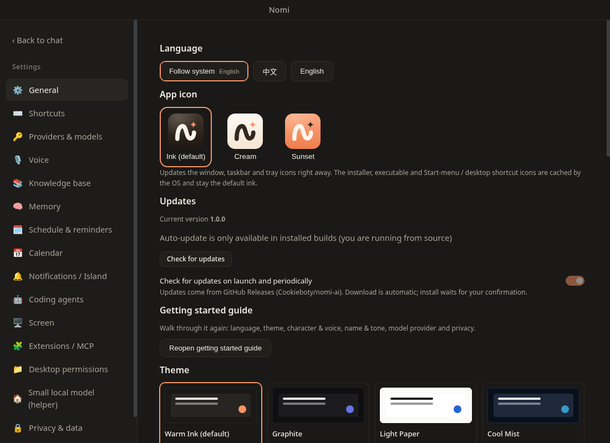

# 个性化

## 主题

设置 → 主题：**暖墨**（默认）、**石墨**、**纸白**、**冷雾**，或「跟随系统」（深色用石墨、浅色用纸白）。对话窗口、设置、引导和标题栏一起切换。

## 应用图标

设置 → 应用图标：**墨色**（默认）、**奶油**、**日落橙**。窗口、任务栏和托盘图标即时更新；安装包、可执行文件和开始菜单 / Finder 里的静态图标保持默认。图标素材见 [品牌规范](../BRAND.md)。

## 快捷键

设置 →「快捷键」列出全部快捷键：点「修改」后按下新的组合键（需包含 `Ctrl/⌘` 或 `Alt`，或使用 F1–F12），冲突时会提示；`Esc` 取消。

| 默认             | 作用            |
| ---------------- | --------------- |
| `Ctrl/⌘+K`       | 命令面板        |
| `Ctrl/⌘+N`       | 新对话          |
| `Ctrl/⌘+L`       | 聚焦输入框      |
| `Ctrl/⌘+,`       | 打开设置        |
| `Ctrl/⌘+B`       | 收起 / 展开侧栏 |
| `Ctrl/⌘+Shift+K` | 知识库问答开关  |
| `Ctrl/⌘+Shift+S` | 截图提问        |
| `Ctrl/⌘+Shift+H` | 免按键对话开关  |
| `Ctrl/⌘+Shift+M` | 记忆            |
| `Ctrl/⌘+Shift+L` | 知识库          |
| `Ctrl/⌘+Shift+D` | 日程与提醒      |
| `Ctrl/⌘+Shift+E` | 扩展 / MCP      |
| `Ctrl/⌘+Shift+J` | 本机管理        |
| `Ctrl/⌘+Shift+O` | 屏幕记忆        |

固定快捷键：输入框里 `/` 打开命令，`Enter` 发送、`Shift+Enter` 换行，按住 `F2` 说话。全局快捷键 `Ctrl/⌘+Alt+A` 截图提问。

## 语言

设置 → 语言：中文、English 或跟随系统。

## 无障碍

- 所有功能都可以用键盘完成；图标按钮都有可读的名称。
- 弹窗会锁定焦点，`Esc` 只关闭最上层，关闭后焦点回到打开它的位置。
- 开启系统的「减少动态效果」后，Nomi 的摆动幅度、灵动岛与界面动画都会收敛。
