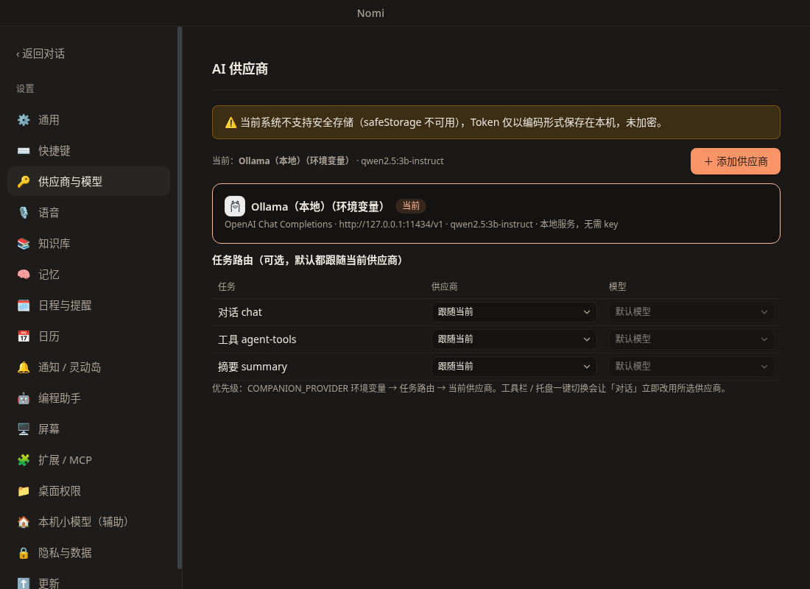

# 供应商与 Token 管理

入口：设置 →「编程助手」→ Nomi 标签（原「供应商与模型」），或对话窗口输入框旁的 🔑。

## 一键切换

对话窗口底部的**供应商下拉框 + 模型下拉框**，以及系统托盘的「AI Provider」菜单，都可以一键切换，下一次请求立即生效。

## 添加供应商

- 搜索或按分类（自定义配置 / 模型厂商 / 第三方平台）选择预设：OpenAI、Anthropic、Google Gemini、DeepSeek、Kimi、智谱 GLM、通义千问、火山方舟豆包、MiniMax、xAI Grok、OpenRouter、SiliconFlow 硅基流动、Amux、Ollama（本地）、LM Studio（本地）。
- 预设只预填名称、官网、请求地址和协议，保存后都能修改；也可以选「自定义配置」接入任何兼容服务。
- **获取模型**：一键拉取该供应商的模型列表，勾选启用、设为默认；不支持列表的服务可以手动填写模型 ID。
- **测速**：发一个极小的请求，显示实际延迟。
- 高级选项（默认折叠）：上游协议（OpenAI Chat Completions / OpenAI Responses / Anthropic Messages）、模型映射、思考开关、自定义请求头与 User-Agent。

## 多 Key 自动切换

每个供应商可以有一个主 Key 和多个备用 Key。主 Key 遇到鉴权失败、限流或额度用尽时自动切换到下一个；界面只显示掩码。

## 按任务分配模型

「任务路由」里可以让 **对话**、**工具调用**、**摘要** 分别使用不同的供应商与模型；默认都跟随「当前供应商」。在工具栏或托盘一键切换时，对话会立即改用所选供应商。

## 安全

- API Key 用系统安全存储加密（macOS 钥匙串 / Windows DPAPI / Linux libsecret·kwallet），保存在本机 `ai-providers.json`（权限 0600）。系统安全存储不可用时只做编码保存，面板会显示明确警告。
- 保存后界面只能拿到掩码；Key 只随请求发往你为该供应商配置的地址，不上报、不同步。
- 删除供应商会同时删除它的全部 Key 与本地用量记录。

## 技术说明

- 也可以用环境变量提供供应商（如 `DEEPSEEK_API_KEY`、`OPENAI_API_KEY`、`ANTHROPIC_API_KEY`、`GEMINI_API_KEY`、`OLLAMA_BASE_URL`），它们在面板里只读显示；`NOMI_PROVIDER=<id>` 可强制指定供应商。
- 选择顺序：`NOMI_PROVIDER` → 任务路由 → 当前供应商 → 环境变量供应商。
- 服务商图标来自 `@lobehub/icons-static-svg`（MIT），仅用于标识对应服务；没有图标时显示首字母头像。

## Claude Code / Codex / dsh 的供应商

「编程助手」页的另外三个标签（Claude Code / Codex / dsh）与 Nomi 使用同样的卡片列表、预设模板、添加 / 编辑 / 删除 / 测速 / 启用。默认使用各 CLI 自带的登录或默认配置，不启用任何档案；档案库与 Nomi 互相独立。详见 [编程助手接入设计稿 §14](coding-agent-harness.md)。每个端点页顶部还有「版本」卡片，可检查并一键安装 / 更新该 CLI（执行前会显示完整命令并确认）。
